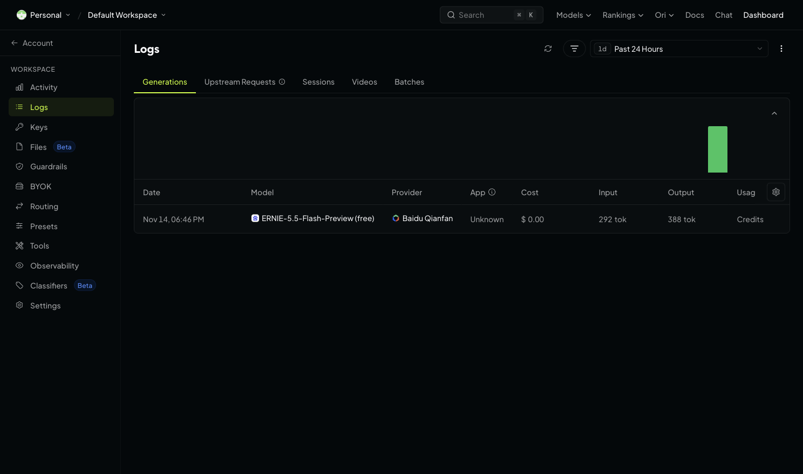
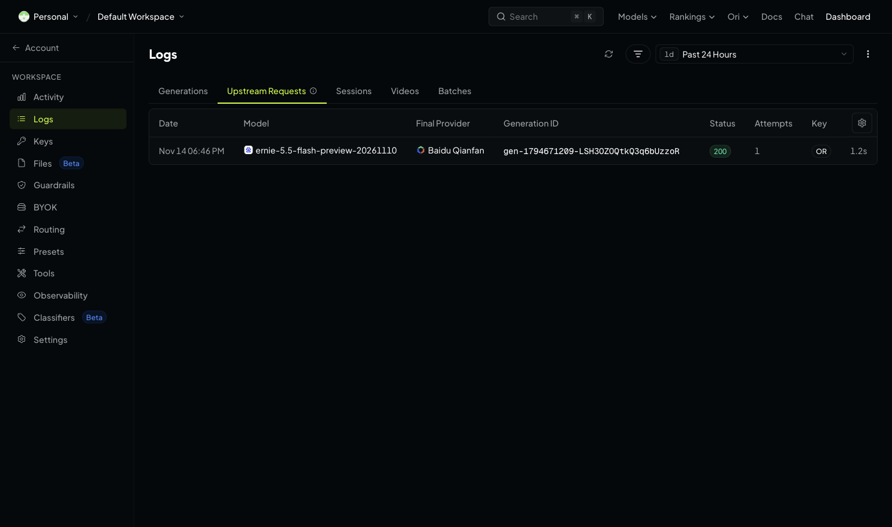

# Build Notes — Claim 1 Routing Run

**Date:** 2026-11-14
**Model:** `baidu/ernie-5.5-flash-preview:free` — read from `OPENROUTER_MODEL` in a git-ignored `.env`.
The API key (`OPENROUTER_API_KEY`) lives in the same ignored file and never appears in code, chat, or this repo.

## Command

```bash
.venv/bin/python -I run_claim.py --claims shopify_amazon_refund_claims_labeled.csv --claim-id CLM-0001
```

The router received **claim 1's `claim_text` only** — no labels, no amounts, no
investigator notes. The OpenRouter request used structured output
(`response_format: json_schema`, strict) and the reply was validated by the
Pydantic checker before anything was printed.

## Printed decision (verbatim from the run)

```json
{
  "claim_id": "CLM-0001",
  "model": "baidu/ernie-5.5-flash-preview:free",
  "decision": {
    "specialists": [
      "billing",
      "shipping",
      "stock"
    ],
    "reason": "The claim describes a duplicate charge (“card was charged twice for the whole order”), a missing item from the delivery (“only one box showed up with the stroller”), and an inventory problem (“car seat is out of stock”).",
    "confidence": 0.95
  },
  "label_specialists": "billing|shipping|stock",
  "match": true
}
```

## How the specialists match `label_specialists`

| Router says | Investigator label | Verdict |
|---|---|---|
| `["billing", "shipping", "stock"]` | `billing\|shipping\|stock` | **Exact match — 3/3** |

- **billing** ↔ duplicate charge ("my card was charged twice for the whole order")
- **shipping** ↔ missing shipment ("Only one box showed up with the stroller")
- **stock** ↔ oversold line ("the seller page says the car seat is out of stock")

This also demonstrates the design decision recorded in the README: one claim
*can* list more than one specialist, so `specialists` is a set of 1–3 values.

## Key prompt excerpt

> "You route Amazon A-to-z refund claims to specialist teams.
> Specialists and their signals: **billing**: money problems — duplicate/double
> charges, a charge posted after a cancellation…; **shipping**: delivery problems
> — package lost, tracking stalled…, 'delivered' but nothing arrived…;
> **stock**: inventory problems — item oversold or out of stock… A claim may
> need one, two, or all three specialists; include every specialist whose
> problem the claim text actually describes. Judge only from the claim text…"

Full prompt: `router.py::ROUTER_SYSTEM_PROMPT`.

### The part that tells the model to return the schema

Sent with every request as `response_format: json_schema` — **this only
constrains the reply; it is not trusted as enforcement** — plus this
instruction in the fallback path (`router.py::JSON_ONLY_HINT`):

> "Reply with ONLY a JSON object: `{"specialists": ["billing"], "reason": "...", "confidence": 0.0}` where specialists is a non-empty array drawn from billing, shipping, stock and confidence is a number between 0 and 1."

And the schema itself (`router.py::JSON_SCHEMA`):

```json
"schema": {
  "type": "object",
  "properties": {
    "specialists": {
      "type": "array", "minItems": 1,
      "items": {"type": "string", "enum": ["billing", "shipping", "stock"]}
    },
    "reason": {"type": "string", "minLength": 1},
    "confidence": {"type": "number", "minimum": 0, "maximum": 1}
  },
  "required": ["specialists", "reason", "confidence"],
  "additionalProperties": false
}
```

Enforcement stays on our side: every reply is validated by the Pydantic
checker (`check_decision`) before anything is printed or used — the API's
`response_format` only asks the provider to constrain generation and can be
ignored by models without structured-output support (that is what the
prompt-only fallback is for).

## Evidence — the request on OpenRouter

Screenshot of Logs → Generations showing the routing call for claim 1:


Row: **Nov 14, 06:46 PM · ERNIE-5.5-Flash-Preview (free) · provider Baidu
Qianfan · 292 tok input / 388 tok output · $0.00**. This is the display form of
the model id printed in the decision above — `baidu/ernie-5.5-flash-preview:free`,
read from `OPENROUTER_MODEL` in `.env`.

Upstream detail (resolved snapshot):


Row: `ernie-5.5-flash-preview-20261110`, final provider Baidu Qianfan, status
**200**, generation `gen-1794671209-LSH3OZOQtkQ3q6bUzzoR`, 1 attempt. OpenRouter
resolves the `:free` alias to its current dated snapshot, which is why the
upstream row carries the `-20261110` suffix.

## What I checked

Checked against the label: the routed set `{billing, shipping, stock}` equals the investigator's `billing|shipping|stock` → **exact 3/3 match** (`label_match` in `run_claim.py`, compared after the decision was printed).

## Test suite

35 pytest tests passing — checker rejections (only billing/shipping/stock,
confidence 0–1, no duplicates/empties), router structured-output fallback and
reprompt paths, and label matching.
