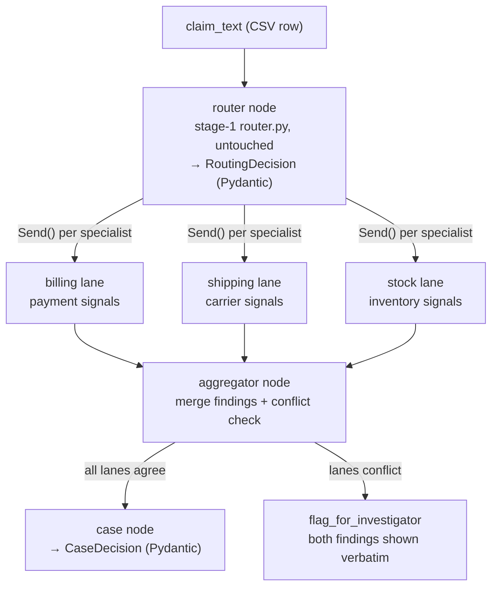

# Stage 2 sketch — LangGraph claims graph (design, pre-code)

Status: SKETCH — nothing here is implemented yet. This records the lane design
and the worked trace we agreed on before coding starts.

## The three specialist lanes

One LangGraph `StateGraph`. Stage 1's router becomes the sorter node, unchanged.

- **billing lane** — duplicate charges, charges after cancellation, fee/amount
  mismatches, missing credits.
- **shipping lane** — lost packages, stalled tracking, "delivered" but nothing
  arrived, items missing from the box. Two distinct shipping defects with two
  distinct records: a **lost-parcel defect** rests on the carrier tracking record
  (a parcel exists but never arrived — CLM-0003/0006/0012), while a
  **never-shipped defect** rests on the shipment manifest / pack-and-release
  record (an order line never entered the delivery stream — no parcel exists to
  track, CLM-0001). The successful delivery of other lines in the same order is
  not a defect.
- **stock lane** — oversold lines, no restock date, lines canceled for
  unavailability.

### Lane ownership — the call everything downstream depends on

**Lanes are assigned by the root cause of the defect, not by the remedy.**
Every lane's remedy is money back; what separates them is *which record the
defect lives in*.

| Lane | Owns (root cause) | Evidence view | Does NOT own |
|---|---|---|---|
| billing | money movements wrong in themselves: duplicate charges, charge after cancellation, fee/amount mismatch, missing credit/refund | payment records | why an item didn't ship or arrive |
| shipping | fulfillment/delivery: lost, stalled tracking, "delivered" but not received, item missing from the box | carrier scans, delivery records | whether stock existed |
| stock | supply: oversold, no restock date inside the promised window, line canceled for unavailability | inventory records | whether the payment was correct |

Rules that follow:

1. **One lane per distinct defect root cause.** A sold-out car seat with no
   restock date routes to **stock only** — the charge for that line was correct,
   so billing has no defect to find; the refund is the *remedy*, decided once
   downstream by the case node, not a reason to involve billing. Billing judging
   inventory with payment records would double-own one defect and can raise a
   false disagreement flag.
2. **A claim with several defects fans out to several lanes** — claim 1 carries
   three distinct defects, each with its own owner: double charge → billing,
   car seat line never shipped → shipping, car seat sold out → stock.
3. **Boundary example (CLM-0014):** seller canceled a sold-out pack (stock
   defect) *and* payment captured both packs (billing defect) — two genuine
   defects, hence the `billing|stock` label. Co-labeling happens when two root
   causes really exist, never because the remedy is a refund.

Each lane is the same node shape with a different specialist prompt and its own
typed finding schema — one OpenRouter structured-output call per lane, temperature 0.

## State and schemas

- `ClaimGraphState` — `claim_id`, `claim_text`, `routing_decision: RoutingDecision`,
  `findings` (reducer: append — lanes fan out in parallel), `disagreements`, `case_decision`.
- `SpecialistFinding` (Pydantic, same checker discipline as stage 1):
  `specialist` (enum), `verdict` (enum: `action_refund` / `no_action` / `needs_evidence`),
  `evidence` (cited from claim text), `confidence` (0–1).
- `CaseDecision` (Pydantic): per-lane verdicts, refund recommendation,
  `disagreements` list, overall confidence.
- Fan-out uses LangGraph's `Send` API: the graph spawns exactly one lane task per
  specialist in `RoutingDecision.specialists` — a 1-specialist claim runs 1 lane,
  a 3-specialist claim runs 3 in parallel.
- LangSmith hook point: trace each lane as a child run of the router so every
  helper is watchable (meeting-notes requirement), without changing node logic.

## Disagreement rule ("when two helpers disagree, show their findings")

The aggregator never silently merges conflicting verdicts. If two lanes disagree
about the same claim (verdicts contradict, or evidence conflicts — carrier says
"delivered" while stock says "never picked"), the aggregator emits a
`disagreements` entry containing **both findings verbatim** and routes the case
to `flag_for_investigator` instead of a refund verdict.

The converse is corroboration: two lanes citing **different records about the
same line** (shipment manifest says it never shipped; inventory says it was
oversold) agree — the records complement each other, they do not conflict.
Corroborating findings merge normally; only contradicting records conflict.

## Worked trace — the sold-out car seat claim (CLM-0001)

Claim: stroller + car seat, card charged twice for the whole order, only the
stroller box arrived, seller page now says the car seat is out of stock.

1. **router node** → `["billing", "shipping", "stock"]` (the stage-1 result,
   confidence 0.95) → graph sends **three parallel lane tasks** — one per
   distinct defect root cause.
2. **billing lane** → its defect is the duplicate settled charge (not the car
   seat) → `action_refund` for the extra charge.
3. **shipping lane** → its defect is the **car seat line that never shipped** —
   the stroller box that did arrive was a normal, successful delivery, not a
   defect. Rests on the **shipment manifest record** (order has two lines, only
   the stroller line was ever packed and released; no parcel exists for the car
   seat) — not on carrier tracking, which correctly delivered the one parcel
   that existed → `action_refund` (never-shipped line).
4. **stock lane** → car seat oversold, no restock date → `action_refund` (canceled line).
5. **aggregator** → three findings, no contradictions. Note: shipping ("no
   shipment ever existed for line 2") and stock ("line 2 was oversold") are two
   different records about the same line — cross-domain **corroboration**, not
   disagreement → case = partial refund (missing line + extra charge) — matches
   the label `partial_refund`, 489.98.

Contrast — a claim that is *only* sold-out (CLM-0004, baby monitor): router
returns `["stock"]` alone → single lane → `full_refund` for the one line.

## Carried over from stage 1

`schema.py`, `checker.py`, `config.py`, `router.py` (as the router node), the
TDD discipline (schemas and the disagreement rule get failing tests first), and
the `.env` secret handling. Free-tier rate limits: lanes run in parallel but
each lane call reuses the router's retry/fallback mechanics.

## Naming note (feedback from stage 1 review)

Stage pages name deliverables exactly (e.g. `shopify_amazon_refund_claims_labeled.csv`).
Stage 2 files follow the stage page's names verbatim, not convenient renames.
