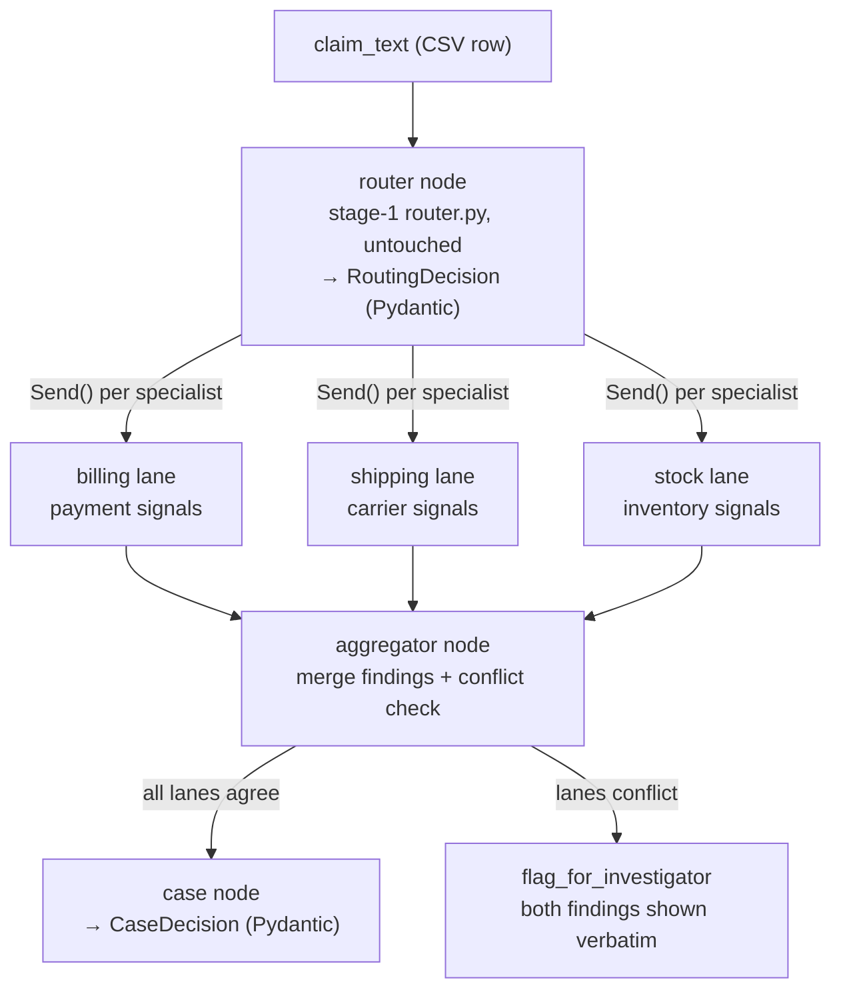

# Stage 2 sketch — LangGraph claims graph (design, pre-code)

Status: SKETCH — nothing here is implemented yet. This records the lane design
and the worked trace we agreed on before coding starts.

## The three specialist lanes

One LangGraph `StateGraph`. Stage 1's router becomes the sorter node, unchanged.

- **billing lane** — duplicate charges, charges after cancellation, fee/amount
  mismatches, missing credits.
- **shipping lane** — lost packages, stalled tracking, "delivered" but nothing
  arrived, items missing from the box.
- **stock lane** — oversold lines, no restock date, lines canceled for
  unavailability.

Each lane is the same node shape with a different specialist prompt and its own
typed finding schema — one OpenRouter structured-output call per lane, temperature 0.

## State and schemas

- `ClaimGraphState` — `claim_id`, `claim_text`, `routing_decision: RoutingDecision`,
  `findings` (reducer: append — lanes fan out in parallel), `disagreements`, `case_decision`.
- `SpecialistFinding` (Pydantic, same checker discipline as stage 1):
  `specialist` (enum), `verdict` (enum: `action_refund` / `no_action` / `needs_evidence`),
  `evidence` (cited from claim text), `confidence` (0–1).
- `CaseDecision` (Pydantic): per-lane verdicts, refund recommendation,
  `disagreements` list, overall confidence.
- Fan-out uses LangGraph's `Send` API: the graph spawns exactly one lane task per
  specialist in `RoutingDecision.specialists` — a 1-specialist claim runs 1 lane,
  a 3-specialist claim runs 3 in parallel.
- LangSmith hook point: trace each lane as a child run of the router so every
  helper is watchable (meeting-notes requirement), without changing node logic.

## Disagreement rule ("when two helpers disagree, show their findings")

The aggregator never silently merges conflicting verdicts. If two lanes disagree
about the same claim (verdicts contradict, or evidence conflicts — carrier says
"delivered" while stock says "never picked"), the aggregator emits a
`disagreements` entry containing **both findings verbatim** and routes the case
to `flag_for_investigator` instead of a refund verdict.

## Worked trace — the sold-out car seat claim (CLM-0001)

Claim: stroller + car seat, card charged twice for the whole order, only the
stroller box arrived, seller page now says the car seat is out of stock.

1. **router node** → `["billing", "shipping", "stock"]` (the stage-1 result,
   confidence 0.95) → graph sends **three parallel lane tasks**.
2. **billing lane** → duplicate settled charge → `action_refund` (the extra charge).
3. **shipping lane** → only one box delivered; the car seat line never shipped →
   `action_refund` (missing shipment).
4. **stock lane** → car seat oversold, no restock date → `action_refund` (canceled line).
5. **aggregator** → three findings, no contradictions → case = partial refund
   (missing line + extra charge) — matches the label `partial_refund`, 489.98.

Contrast — a claim that is *only* sold-out (CLM-0004, baby monitor): router
returns `["stock"]` alone → single lane → `full_refund` for the one line.

## Carried over from stage 1

`schema.py`, `checker.py`, `config.py`, `router.py` (as the router node), the
TDD discipline (schemas and the disagreement rule get failing tests first), and
the `.env` secret handling. Free-tier rate limits: lanes run in parallel but
each lane call reuses the router's retry/fallback mechanics.

## Naming note (feedback from stage 1 review)

Stage pages name deliverables exactly (e.g. `shopify_amazon_refund_claims_labeled.csv`).
Stage 2 files follow the stage page's names verbatim, not convenient renames.
